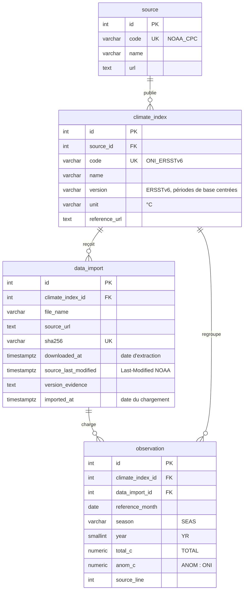

# Base de données PostgreSQL

Schéma mis en place le **14 novembre 2026**, avec l'assistance de Claude :
modèles SQLAlchemy dans [`backend/app/models.py`](../backend/app/models.py), première
migration Alembic [`86057118b37f`](../backend/alembic/versions/86057118b37f_schema_initial_des_observations.py).
Aucune observation NOAA n'est encore importée.

## 1. Schéma relationnel

| Entité du dossier | Table | Rôle |
| --- | --- | --- |
| Source | `source` | Producteur des données (NOAA CPC) |
| Indice | `climate_index` | Série dans une version confirmée (ONI ERSSTv6) |
| Import | `data_import` | Un fichier brut chargé : sa provenance et la date du chargement |
| Observation | `observation` | La valeur d'une saison NOAA |

**Cardinalités.**
- Une source publie zéro ou plusieurs indices ; un indice appartient à une seule source.
- Un indice reçoit zéro ou plusieurs imports ; chaque nouvelle extraction du fichier NOAA est un import.
- Un import charge zéro ou plusieurs observations ; une observation est reliée à un seul import, celui qui l'a chargée.
- Une observation appartient à un seul indice, qui est obligatoirement celui de son import (clé étrangère composite, section 3).

**Retrouver l'origine d'une observation** : `observation` → `data_import`
(fichier, URL, SHA-256, date d'extraction, ligne `source_line`) → `climate_index`
(série et version) → `source` (producteur).

## 2. Types des colonnes

| Colonne | Type SQL | Justification |
| --- | --- | --- |
| `reference_month` | `DATE` | 1er jour du mois central (règle D12), pour trier et filtrer par période. Une convention de date, pas une mesure ce jour-là |
| `season` | `VARCHAR(3)` | Code `SEAS` d'origine, limité aux 12 codes NOAA par une contrainte |
| `year` | `SMALLINT` | `YR` d'origine (année du mois central) |
| `total_c`, `anom_c` | `NUMERIC(4, 2)` | Valeurs **exactes** à deux décimales, comme dans le fichier NOAA. Un `float` stockerait par exemple 0,1 de façon approchée |
| `source_line` | `INTEGER` | Ligne du fichier brut, pour retrouver la valeur publiée |
| `downloaded_at`, `source_last_modified`, `imported_at` | `TIMESTAMPTZ` | Instants avec fuseau horaire, comparables entre eux |
| `sha256` | `VARCHAR(64)` | Empreinte hexadécimale du fichier |

`period_start` et `period_end`, présents dans le CSV, ne sont pas stockés : ils se
déduisent de la saison et de l'année. Les stocker créerait un risque d'incohérence.

## 3. Intégrité

### Clés

- Clé primaire `id` (entier auto-incrémenté) dans chaque table.
- Clés étrangères : `climate_index.source_id`, `data_import.climate_index_id`,
  `observation.climate_index_id`.
- Clé étrangère composite `observation (data_import_id, climate_index_id)` →
  `data_import (id, climate_index_id)`. Elle empêche de rattacher une observation
  d'un indice à l'import d'un autre indice, par exemple une valeur ONI à un fichier
  RONI.
- Pas de suppression en cascade : un import qui a des observations ne peut pas
  être supprimé, ce qui protège leur provenance.
- Toutes les colonnes sont obligatoires (`NOT NULL`), sauf `source_last_modified`,
  car le serveur ne fournit pas toujours cet en-tête.

### Contraintes d'unicité

| Contrainte | Colonnes | Effet |
| --- | --- | --- |
| `uq_observation_climate_index_id_year_season` | `climate_index_id, year, season` | Une seule valeur par saison et par série |
| `uq_data_import_sha256` | `sha256` | Un même fichier n'est enregistré qu'une fois |
| `uq_source_code`, `uq_climate_index_code` | `code` | Codes lisibles uniques, ex. `ONI_ERSSTv6` |

La contrainte d'observation part de `UNIQUE (year, season)`, adaptée au schéma
réel de deux façons :
- **`data_import_id` n'en fait pas partie.** Deux imports différents ne peuvent
  donc pas créer deux fois la même saison. Si l'import en faisait partie, chaque
  nouvelle extraction NOAA dupliquerait les 921 saisons.
- **`climate_index_id` en fait partie.** Une seconde série, par exemple la RONI,
  pourra avoir sa propre valeur pour `DJF 2000` sans conflit.

### Contrôles (`CHECK`)

| Contrainte | Règle |
| --- | --- |
| `ck_observation_season_code` | `season` parmi les 12 codes NOAA |
| `ck_observation_year_min` | `year >= 1950`, début de la série ONI |
| `ck_observation_reference_month_central` | `reference_month` = 1er jour du mois central de `season`, dans l'année `year` |
| `ck_observation_total_physical_range` | `total_c` entre −2 et 40 °C |
| `ck_observation_anom_physical_range` | `anom_c` entre −10 et +10 °C |
| `ck_observation_source_line_after_header` | `source_line > 1`, la ligne 1 étant l'en-tête |
| `ck_data_import_sha256_hex` | 64 caractères hexadécimaux en minuscules |
| `ck_data_import_imported_after_download` | Le chargement ne peut pas précéder le téléchargement |

Les bornes physiques et la règle de datation sont les mêmes que dans la
transformation (décisions D12 et D18). La base les garantit à son tour, quel que
soit le programme qui écrit les données.

### Index pour le filtre par période

`ix_observation_climate_index_id_reference_month` sur `(climate_index_id, reference_month)`
correspond à la requête prévue pour l'API : les observations d'une série, entre
deux dates, triées par date. PostgreSQL peut lire ces lignes directement dans
l'ordre, sans tri. Avec 921 lignes, le gain reste faible. L'index sert surtout à
garder des requêtes efficaces si la série s'allonge ou si d'autres séries sont
ajoutées.

## 4. Provenance : où l'enregistrer

| Information | Emplacement | Valeur pour le fichier du 9 novembre 2026 |
| --- | --- | --- |
| Origine (producteur) | `source.name`, `source.url` | NOAA Climate Prediction Center |
| Série et version confirmée | `climate_index.code`, `climate_index.version` | `ONI_ERSSTv6` ; ERSSTv6, périodes de base centrées |
| Preuve de la version | `data_import.version_evidence` | Intitulé de la page d'index NOAA et comparaison au tableau v6 (D10) |
| URL du fichier | `data_import.source_url` | `https://www.cpc.ncep.noaa.gov/data/indices/oni.ascii.txt` |
| Fichier et empreinte | `data_import.file_name`, `data_import.sha256` | `noaa-cpc_oni-ersstv6_2026-11-09.txt`, `118c5633…0f7f` |
| Date d'extraction | `data_import.downloaded_at` | 9 novembre 2026, 13:42 UTC |
| Dernière modification NOAA | `data_import.source_last_modified` | 3 novembre 2026, 19:31:48 GMT |
| Date du chargement en base | `data_import.imported_at` | Fixée par PostgreSQL au moment de l'import |

La date d'extraction (téléchargement du fichier) et la date de chargement
(`imported_at`) sont deux colonnes distinctes. Un fichier n'est rattaché à un
indice qu'une fois sa version confirmée : `climate_index_id` et
`version_evidence` sont obligatoires.

## 5. Hypothèses à confirmer avant l'import

1. **Provenance lisible par un programme.** URL, dates et version figurent
   aujourd'hui dans [`data/raw/README.md`](../data/raw/README.md), en Markdown.
   L'import aura besoin d'une forme lisible par un script, ou de ces valeurs en
   paramètres.
2. **Date d'extraction retenue.** L'horloge locale indiquait 13:42:23 UTC et
   l'en-tête `Date` du serveur NOAA 13:42:35 GMT. Proposition : l'en-tête du
   serveur.
3. **Lignes de référence.** `source` et `climate_index` sont vides : l'import
   les créera, ou les retrouvera par leur `code`. La migration ne contient que
   la structure.
4. **Révisions NOAA.** Lors d'un import ultérieur, une saison déjà présente peut
   avoir la même valeur ou une valeur révisée. La règle reste à décider : garder,
   mettre à jour en la rattachant au nouvel import, ou refuser. La contrainte
   d'unicité interdit en tout cas d'en garder deux.
5. **Troisième décimale.** `NUMERIC(4, 2)` arrondirait sans erreur une valeur à
   trois décimales. Le CSV actuel n'en contient aucune, au maximum deux. L'import
   devra refuser toute valeur plus précise.
6. **Emplacement du chargement.** Les modèles sont dans `backend/`, alors que la
   transformation est dans `etl/`. Le programme d'import devra utiliser les deux
   (voir D15 et D20).

## 6. Commandes

Voir le [README](../README.md#base-de-données-postgresql). Les tests du schéma
([`backend/tests/test_schema.py`](../backend/tests/test_schema.py)) créent le schéma
par la migration sur une base jetable, puis vérifient :
- le refus d'un doublon venant de deux imports différents ;
- la cohérence entre indice et import ;
- les contrôles `CHECK` ;
- le retour arrière de la migration.
